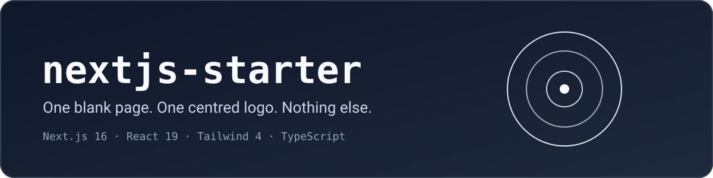

<p align="center"></p>

<p align="center">
  
  
  
  
</p>

> [!NOTE]
> **Status: stub (2026-11-16).** A fresh `create-next-app` project with one change: the home page shows the ZenLens logo, centred, on white. There is no app behind it, no tests and no deployment config. See [docs/STATUS.md](docs/STATUS.md).

## What it is

A starting point for a ZenLens web page. The home page (`src/app/page.tsx`) renders `public/zenlens-logo.png` in the middle of the screen and nothing else. It is probably a placeholder for a landing page **(inference)**.

## Run it

Next 16 needs Node 20.9 or newer (its `engines` field); the checks here ran on Node 22.

```sh
npm ci
npm run dev      # http://localhost:3000
npm run build    # verified 2026-11-20: builds, / is prerendered static
npm run lint     # clean on 2026-11-20
```

## Layout

```
src/app/page.tsx       the centred logo
src/app/layout.tsx     root layout and fonts
src/app/globals.css    Tailwind 4 import
public/zenlens-logo.png  the logo
public/*.svg           leftover create-next-app icons, unused
AGENTS.md              rules for agents (starts with Next.js's own block)
```

## History

- 2026-11-16 15:02: `create-next-app` scaffold.
- 2026-11-16 15:04: blank page with the centred ZenLens logo. Two commits, no changes since.

More: [docs/STATUS.md](docs/STATUS.md), [AGENTS.md](AGENTS.md), [CONTRIBUTING.md](CONTRIBUTING.md), [SECURITY.md](SECURITY.md). This repo is public and has no license file, so by default all rights are reserved.
